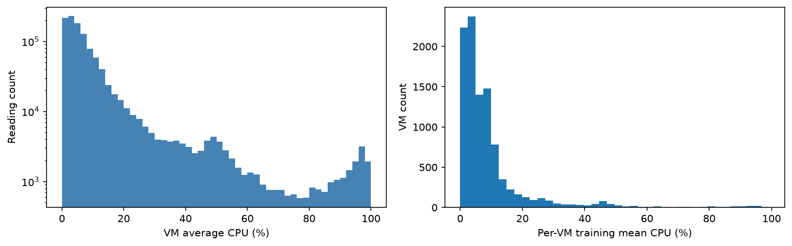
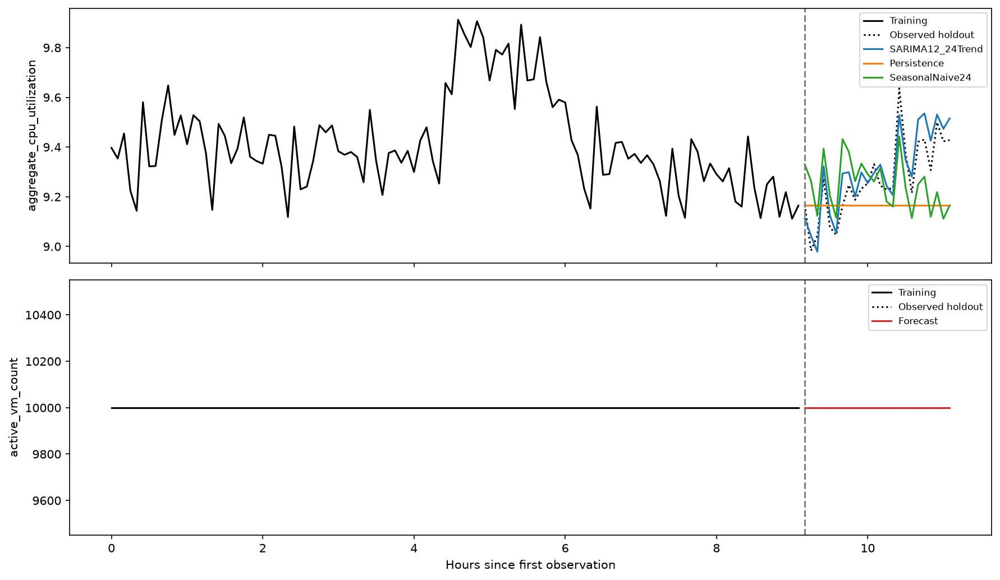

# Cloud workload forecasting: final report

## 1. Executive summary

The supplied release contains 10,000 VMs and 134 five-minute observations per VM. I forecast the final 24 timestamps from the first 110, using a fixed combination of two SARIMA models. Each of nine category/subscription-size groups is forecast independently, then combined using its VM count. VM count itself uses persistence because this curated cohort has no observed membership changes.

The fixed CPU recipe achieves **MAE 0.0579 percentage points and RMSE 0.0676** on the public final window, versus persistence MAE 0.1468. However, training-only validation is less favorable: MAE 0.2097, only 2.45% below persistence, and worse than standalone SARIMA-24 and seasonal-naive-12. These distinctions matter more than the attractive final score.

The public holdout was inspected during iterative notebook/model exploration. Its scores are **retrospective**, not an untouched estimate of model-selection performance. The model specification is fixed during execution. Runtime fitting uses training prefixes only; independent generalization requires new chronological data.

## 2. Data understanding and preprocessing

The solution reads `vm_cpu_readings.csv.gz` and `vm_metadata.csv.gz` directly. No merged dataset is supplied or required. Timestamps are seconds relative to the source trace, not hours or calendar dates. The official training indices 0–109 correspond to timestamps 0–32700; predictions cover 33000–39900. Interval coverage is 9.167 training hours, while elapsed time between first and last training timestamps is 9.083 hours.

The raw audit finds 1,340,000 readings, 10,000 metadata rows, no missing source cells, no exact target duplicates, no missing grid timestamps and no missing VM/timestamp readings. Interval min/average/max coherence is audited separately. Metadata IDs must be unique and every observed VM must have metadata; no join can multiply readings.

A valid target reading has a nonmissing VM ID and finite `avg_cpu` in [0,100]. At each timestamp, active count is the number of distinct valid represented VMs, including idle VMs, and aggregate CPU is their equal-VM mean. The full targets are built before splitting. Exact duplicate target observations are collapsed; conflicting duplicate values stop execution. Invalid average readings are excluded from both count and mean without interpolation. Whole source-timestamp gaps or wholly missing training CPU cause an explicit error after audit/target export. Metadata CPU statistics and deletion times never become forecasting inputs.

## 3. Workload findings and implications

**Cadence and coverage.** All 10,000 traces cover all 110 training timestamps at 300-second cadence. Completeness is a selection condition of this release, not evidence that Azure generally has no missing telemetry or churn.

**Missingness, duplicates and irregularities.** The release is clean for the target inputs, but the loader does not silently repair conflicting keys. Reading-derived summaries use positional chronological prefixes. Source lifetime CPU summaries are excluded from forecasting because their temporal availability is not guaranteed.

**Lifetimes and churn.** Unknown VMs have median recorded deletion at 3.6354 days, versus 29.9931 days for the other categories. Records before the maximum deletion boundary have lower median training CPU (3.9698% versus 5.7324%) but higher mean (9.9006% versus 9.3082%); the low-usage interpretation depends on statistic and category. There are 0 internal arrivals and 0 departures. Metadata deletion times concentrate at the maximum for 8,213 VMs, suggesting a trace boundary/censoring effect. Creation at the trace boundary and last observation are not proof of real simultaneous provisioning/deletion. This sample cannot validate a churn model or an unbiased lifetime distribution.

**CPU distributions.** Training mean CPU is 9.414%, median 5.120%; 7.56% of readings are at most 1%, while 1.27% are at least 80%. The top 10% of VMs contribute 43.54% of the sum of per-VM mean percentages. A low fleet mean therefore does not imply every VM or host is safe to downsize.



**Temporal patterns.** Fleet autocorrelation is about 0.667 at five minutes, 0.367 at one hour and -0.026 at two hours. Periods 12 and 24 are short-cycle modeling hypotheses, not established daily/weekly seasons. Trends, transients and aggregation can create or hide apparent repetition. The largest absolute five-minute training ramp is 0.4368 percentage points.


**Jump analysis.** Jump detection uses the rule `abs(five-minute change) > median(abs(change)) + 2 × MAD(abs(change))`. On training data its threshold is 0.2233 pp, flagging 18 changes. The largest rise is 0.4368 pp at timestamp 1500 (25 minutes). Interactive / >20 and Delay-insensitive / >20 contribute 0.1402 and 0.1266 pp respectively. Group changes sum exactly to the fleet change, with no membership changes in this cohort. Adjacent flags can describe the rise and reversal of one event; their timing does not prove stable seasonality. See [jump plot](../notebooks/outputs/jumps.png) and [attribution](../notebooks/outputs/jump_attribution.csv).

**Meaningful segments.** Category populations are 6,180 Delay-insensitive, 3,091 Interactive and 729 Unknown. Each is split by inclusive subscription-size bins 1–3, 4–20 and >20. Sizes count VMs in the supplied metadata, not an organization's complete estate. Unknown labels remain visible. Workload categories do not establish price ratios or latency guarantees; open-ended resource buckets cannot yield exact physical capacity.

| VM type | Subscription size | VMs | Forecast weight |
| --- | --- | ---: | ---: |
| Delay-insensitive | 1-3 | 1,482 | 14.82% |
| Delay-insensitive | 4-20 | 1,439 | 14.39% |
| Delay-insensitive | >20 | 3,259 | 32.59% |
| Interactive | 1-3 | 1,093 | 10.93% |
| Interactive | 4-20 | 885 | 8.85% |
| Interactive | >20 | 1,113 | 11.13% |
| Unknown | 1-3 | 204 | 2.04% |
| Unknown | 4-20 | 343 | 3.43% |
| Unknown | >20 | 182 | 1.82% |


The size cuts retain the original small-group rule at 3 and coarsen the finer size bins into medium (4–20) and large (>20) cohorts. They are an interpretable design choice, not validated optimal breakpoints or proven accuracy gains. [Fine-bin CPU/category graph and rationale](../notebooks/outputs/subscription_size_rationale.png) are reproduced in the metadata notebook.

**Metadata connections.** Shared subscriptions have mean training CPU 9.8267% versus 6.3999% for singletons; shared deployments show 9.8405% versus 6.4070%. These are associations, potentially confounded by category mix and correlated VMs, not causal effects of sharing an ID. The 2-core/32-GB bucket averages 24.3304% but contains only four VMs. Source deletion time has a weak positive Spearman association with training CPU (0.0907), with censoring unresolved. The source P95/average burst gap is a descriptive proxy; its category ordering does not match within-training variability. These relationships are reproduced in [transform.ipynb](../notebooks/transform.ipynb), with details in the [analysis appendix](analysis_and_experiments.md).

**Peaks and lows.** Training P10/P90 CPU thresholds are 9.1792% / 9.6684%, identifying 11 low and 11 peak timestamps. These are relative workload levels, not absolute host capacity violations. Thresholds are recomputed inside each validation prefix. The [training demand figure](../src/results/figures/temporal_demand.png) and [full nine-group histories](../src/results/figures/groups_full_history.png) show the patterns directly.

## 4. Forecasting approach

For each occupied group, fit SARIMA `(1,0,1) x (2,1,0,12)` and `(1,0,1) x (2,1,0,24)`. With five-minute sampling, these periods correspond to one and two hours. Let `p12` and `p24` be their 24-step forecasts and `L(p)` the ordinary least-squares line through those forecast values. The fixed recipe is:

```text
forecast_group = clip(p12 - L(p12) + L(p24), 0, 100)
fleet_cpu = sum(group_vm_count * forecast_group) / sum(group_vm_count)
active_vm_count = last_training_active_vm_count
```

This replaces both the level and slope from SARIMA-12 while retaining its detrended forecast shape. The lines use predicted future means, never observed holdout labels. SARIMA multi-step forecasts evolve their internal states without observing the final window. Static groups use supplied metadata; no calendar assumptions, metadata CPU summaries, deletion times or holdout-based CPU terciles enter forecasting.

Both seasonal models share fixed nonseasonal and seasonal component orders, differing only in period. These orders are not optimized independently by group or period; sensitivity to the specification remains a limitation.

Group weights use valid VM counts at the forecast origin, and assume that represented composition persists. On the complete release these are fixed and reconstruct the equal-VM mean exactly. Sparse/incomplete segment histories use a logged last-valid/seasonal-naive fallback. Fewer than 60 training observations or a constant series also triggers a documented fallback, allowing small reviewer smoke datasets without pretending a complex seasonal model is identifiable. Failed numerical fits are logged and fall back explicitly. All 54 SARIMA fits in the official run converged without fallbacks; convergence alone does not prove adequate residuals.

## 5. Time-aware validation

Validation expands the training prefix and always forecasts 24 steps:

| Origin | Fit indices | Forecast indices | Forecast timestamps |
| --- | --- | --- | --- |
| 62 | 0–61 | 62–85 | 18600–25500 |
| 86 | 0–85 | 86–109 | 25800–32700 |

Both forecast windows are entirely inside the first 110 observations and do not overlap. The same scheme evaluates persistence, seasonal-naive-12/24, standalone SARIMA-12/24 and the fixed combination. No random split is used. Two origins are a limited approximation to production's repeated two-hour forecasting, particularly with only 2.6 two-hour cycles at the first origin.

The forecasting recipe is fixed; validation reports its performance against alternatives rather than selecting a replacement. Earlier alternative-trend validation favored damped Holt (merged MAE 0.1491 versus 0.2097 for the SARIMA-24 trend), but that advantage reversed in the public final window (0.2140 versus 0.0579). This contrary evidence is retained; neither method has established universal superiority. Alternative implementations are omitted from the delivery because the fixed production recipe does not need them.

## 6. Results versus baseline

Metrics below pool the 48 validation forecast errors, rather than averaging fold RMSE values. CPU errors are percentage points. The final 24 values are scored only after predictions and their manifest are written.

| Model | Validation MAE | Validation RMSE | Retrospective MAE | Retrospective RMSE |
| --- | ---: | ---: | ---: | ---: |
| Fixed trend-rewritten SARIMA | 0.2097 | 0.2579 | 0.0579 | 0.0676 |
| SARIMA-12 alone | 0.3139 | 0.3717 | 0.1579 | 0.1905 |
| SARIMA-24 alone | 0.1905 | 0.2624 | 0.0933 | 0.1248 |
| Persistence | 0.2150 | 0.2677 | 0.1468 | 0.1848 |
| Seasonal-naive 12 | 0.1915 | 0.2461 | 0.1400 | 0.1590 |
| Seasonal-naive 24 | 0.2897 | 0.3316 | 0.1464 | 0.1671 |

The fixed recipe's retrospective WAPE is 0.6242%, and its MAE is 60.58% below persistence. WAPE divides total absolute error by total absolute actual utilization, avoiding per-timestamp near-zero denominators. At effectively zero total demand, a perfect zero forecast returns zero and nonzero error returns undefined. Relative improvement is undefined when baseline MAE is effectively zero.

Count MAE and RMSE are zero for both the model and persistence on validation and the public holdout. Count improvement over this perfect baseline is undefined. The result reflects a deliberately complete, fixed cohort; it is not demonstrated skill at forecasting arrivals, departures or telemetry loss.



## 7. Error and failure analysis

The fixed recipe is not the strongest validation model: standalone SARIMA-24 and seasonal-naive-12 have lower MAE. Its mean validation residual, actual minus prediction, is -0.1521 pp, indicating overprediction. Retrospective mean residual is -0.0314 pp. A favorable final score therefore cannot replace the earlier evidence.

Only 6 validation observations exceed their origin's training P90. Their CPU MAE is 0.1595 pp, versus persistence 0.0730 pp. The holdout has **zero** observations at or above the full-training P90, so final-window peak performance is not measurable under this definition. Six earlier peak points are insufficient to establish reliable peak protection.

Aggregation also conceals local failures. The Unknown / 4–20 group, only 343 VMs, has holdout group-mean MAE 1.1398 pp despite fleet MAE 0.0579. Interactive / >20 has group MAE 0.3832 pp. Opposing group errors can cancel, and a mean forecast cannot guarantee performance for a hot VM, host or latency-sensitive segment. No per-VM forecasting accuracy is claimed. See [group metrics](../src/results/holdout_group_metrics.csv) and [horizon errors](../src/results/figures/forecast_errors.png).

The core failure modes are short/unstable cycles, transient level changes, insufficient history and smoothing of abrupt peaks. Missing-history and failed-fit fallbacks are conservative operational behavior, not evidence of seasonal skill.


### Tree-model experiments that did not improve forecasting

The clean nine-group experiments tested fixed Random Forest and gradient-boosted regression settings, with an additive GAM comparator. All used prediction-fed recursive lags and the same 62/86 validation origins. Random Forest and GBM validation fleet MAEs were 0.4109 and 0.4118, versus seasonal-naive-12 at 0.1915. Their retrospective MAEs were 0.1671 and 0.1821, versus persistence at 0.1468. These configurations therefore did not earn a place in the final recipe. Very few group-level training samples and accumulated recursive correction errors are plausible explanations, not proven causes. This does not show that every tree model will fail. Earlier row-level LightGBM notebook scores are not promoted as clean evidence where summary-window or rollout definitions differed. [Reproduction and full comparison](../notebooks/evaluate.ipynb).

## 8. Capacity-planning recommendation

Use the forecast as a workload planning signal, not a direct physical host-sizing instruction. Bucketed cores/memory and equal-VM CPU percentages do not identify exact required cores or safe placement.

The supplied `capacity_plan.csv` adds a one-sided CPU margin: the greater of **1 percentage point** and the 95th percentile of validation underprediction residuals, using only the 48 training-window validation forecasts. For this run the margin is 1.0 pp. A planning level above the training fleet P90 requests a review of the contributing groups and actual host telemetry. This is an empirical scenario buffer, not a calibrated 95% prediction interval.

An additional 2% VM-slot reserve gives 10,200 slots for the 10,000-VM represented population. This is an illustrative scheduling reserve, not a prediction of new VMs, equivalent host capacity or a demand increase. Protect higher-impact/Interactive workloads with local telemetry and SLO information before taking scaling action; the dataset does not supply those guarantees.

The one-point floor flags all 24 final slots for review. That exposes its conservatism: it favors avoiding under-provisioning but can create unnecessary reserve and alerts. Automatic scale-down based solely on the low fleet mean would be unsafe. Recalibrate margins and alert frequency on genuinely new windows, with explicit operational cost/SLO constraints, rather than shrinking buffers to improve this public holdout.

## 9. Limitations, reproduction and next steps

The important limitations are public-holdout exposure during experimentation, only two validation origins, sparse evidence for stable seasonality, fixed seasonal component orders, a curated fixed roster, and weak identifiability of exact capacity from bucketed metadata. Future work should evaluate new chronological windows first, reassess whether seasonal-naive is sufficient, and test group-specific shifts and host-level headroom prospectively.

A further research direction is **usage-informed VM deletion-risk prediction**: estimate next-day deletion probability or remaining lifetime from category, age and prefix-only CPU/idle/variability/trend features. Compare against category/age-only baselines and check effects within categories; Interactive shows nearly no CPU/deletion rank association and Unknown shows a negative one. Longer histories, verified event-versus-censoring labels and chronological time-to-event validation are needed. This short, complete-trace sample does not demonstrate that capability; source lifetime CPU summaries and actual deletion timestamps must not become predictors. See the [detailed finding and proposed study](analysis_and_experiments.md#future-work-usage-informed-deletion-risk-forecasting).

The delivery contains the selected prediction path, four analysis notebooks, compact analysis, tests, this report and generated results. The optional tree-experiment helper is isolated from main and needs only the extra notebook dependencies. From a clean environment:

```bash
python -m pip install -r requirements.txt
python main.py --data-dir /path/to/challenge_data --evaluate
python -B -m unittest discover -s tests -v
```

A fresh virtual environment installed only the declared requirements. An isolated copy, run from an unrelated directory, reproduced the official raw-data predictions in about 161 seconds on the test machine. Fifteen behavioral tests passed, including duplicate handling, inclusive bucket edges, changed holdout targets/source metadata summaries, empty groups, nonzero timestamps and a raw-file-only CLI run. `src/results/run_manifest.json` records source/prediction hashes, exact dependency versions, training bounds and all forecast timestamps.

Sources: [Azure Public Dataset V2 documentation](https://github.com/Azure/AzurePublicDataset/blob/master/AzurePublicDatasetV2.md), the supplied challenge data card/assignment/submission contract, and [statsmodels SARIMAX](https://www.statsmodels.org/stable/generated/statsmodels.tsa.statespace.sarimax.SARIMAX.html). Notebook organization and analytical scope are documented in [the analysis guide](../analysis/README.md).
